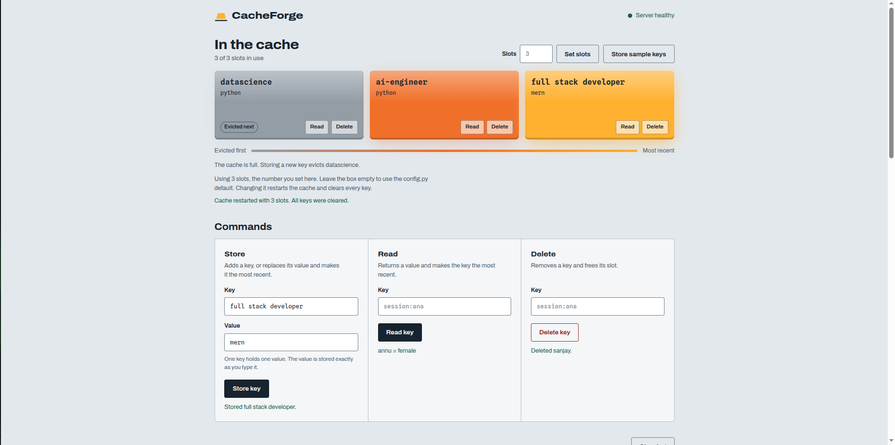
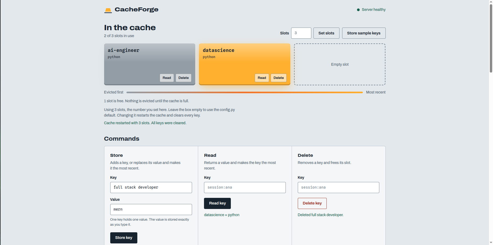
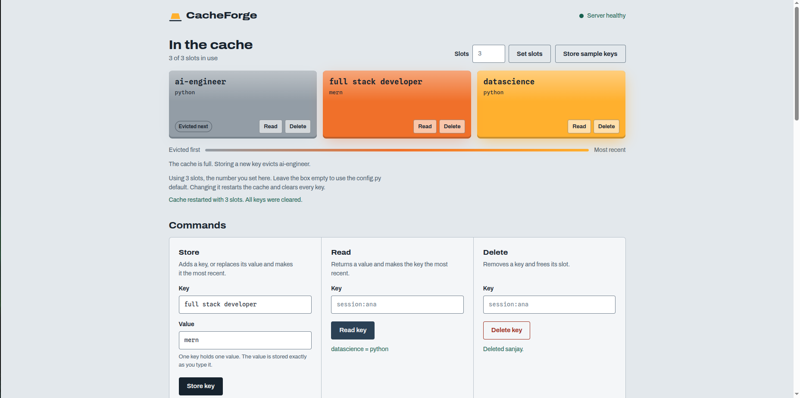
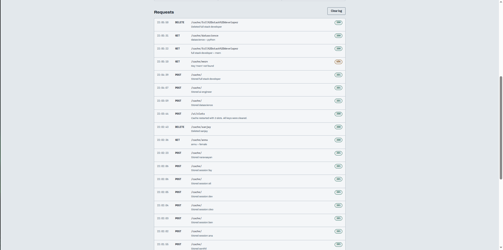

# CacheForge

A small in-memory cache with a REST API, **LRU eviction**, and a web console that shows what the cache is doing as it happens.

Keys live in memory only. When the cache is full, the key that was used least recently is evicted to make room for the new one. The web page draws that rule: every key is an ingot on a rail, **grey is the next to be evicted and amber is the most recently used**.



## Contents

- [What's in the project](#whats-in-the-project)
- [Screenshots](#screenshots)
- [Quick start](#quick-start)
- [How it works](#how-it-works)
- [REST API](#rest-api)
- [The web console](#the-web-console)
- [Configuration](#configuration)
- [Docker](#docker)
- [Project layout](#project-layout)
- [Known limitations](#known-limitations)
- [Roadmap](#roadmap)
- [Tech stack](#tech-stack)

## What's in the project

| Part | Status |
|---|---|
| Key-value storage (set, get, delete) | Done |
| LRU eviction with a fixed capacity | Done |
| REST API with Flask | Done |
| Web console with live eviction view | Done |
| Change the cache size from the web page | Done |
| Run everything with one command (`./start.sh`) | Done |
| Docker image and `docker-compose.yml` | Done |
| TTL-based expiration | Planned |
| Thread safety (locking in the storage layer) | Planned |
| Automated tests (`tests/` is empty) | Planned |

## Screenshots

**Partly full.** Two of three slots are used. Nothing is evicted until the cache is full.



**Full.** The grey ingot is the least recently used and is marked *Evicted next*. Storing a new key pushes it off the rail.



**Request log.** Every call the page makes is listed with the server's real status code and message: `201` stored, `200` read or deleted, `404` key not found.



## Quick start

### Everything together (recommended)

You need **Python 3.10+** with Flask, and **Node.js 18+**.

```bash
python3 -m venv venv
venv/bin/pip install flask
./start.sh
```

Open **http://localhost:3000**. Press `Ctrl+C` to stop both servers.

`start.sh` checks that Python, Flask and Node are installed, refuses to start if port 3000 or 8000 is already in use, waits until the API answers, and writes its output to `.logs/server.log`.

### Backend only

```bash
venv/bin/python main.py
```

The API listens on **http://localhost:8000**. There is no web page in this mode, and the slot count always comes from `src/config.py`.

### Docker

```bash
docker build -t cacheforge:latest .
docker run -d --name cacheforge --init --restart unless-stopped -p 3000:3000 cacheforge:latest
```

See [Docker](#docker) for Compose and configuration.

## How it works

```
Browser ──HTTP──►  Node  frontend/serve.js  (port 3000)  ──HTTP──►  Flask  main.py  (port 8000)
 index.html          · serves the page files                          api/routes.py   REST routes
 styles.css          · forwards /cache/*  ───────────────────────►    src/core.py     CacheEngine
 app.js              · answers /ui/slots itself                       src/storage.py  the cache itself
                     · starts, stops and restarts Flask
```

| Part | Responsibility |
|---|---|
| **Browser** (`app.js`) | Buttons, ingot animation and the request log. Keeps a copy of the key order so it can draw the cache. |
| **Node server** (`serve.js`) | The single entry point on port 3000. Serves the page, forwards cache calls to Flask, and owns Flask's lifecycle. |
| **Flask** (`main.py`, `api/routes.py`) | The REST API. Each route calls the cache engine stored in `app.extensions["cache_engine"]`. |
| **`CacheEngine` → `InMemoryStorage`** | The cache: a Python dictionary where order means recency, plus a capacity limit. |

**Why a Node server sits in the middle.** Flask sends no CORS headers, so a page on one port cannot call Flask on another. The page talks only to port 3000, and Node forwards `/cache/*` requests on.

**Why Node also starts Flask.** The cache size is fixed when `CacheEngine(capacity)` is created at startup, and there is no endpoint to change it. To let you set the size from the page, Node launches Flask with a one-line wrapper that imports the existing `app` from `main.py` and, only when a size was chosen, swaps in `CacheEngine(<size>)`. No Python file is modified.

### The LRU rule

`src/storage.py` keeps entries in a dictionary where **the first key is the least recently used and the last key is the most recent**.

| Operation | What happens to the order |
|---|---|
| `set` an existing key | Key is removed and re-added, so it becomes the most recent. Value is replaced. |
| `set` a new key, room left | Key is added as the most recent. |
| `set` a new key, cache full | The first (oldest) key is removed, then the new key is added. **This is the eviction.** |
| `get` a key that exists | Key moves to the most recent position and its value is returned. |
| `get` a missing key | Nothing changes. |
| `delete` | Key is removed and its slot is freed. |

Reads count as use. A key you keep reading will not be evicted.

### What happens on each action

```
Store    Store key → POST /cache/ {key, value} → Flask posting() → storage.set
         201 → page applies the same LRU rule → ingot appears; the oldest slides off if full
Read     Read key  → GET /cache/<key>          → Flask getting() → storage.get
         200 → ingot re-heats and moves to the hot end        404 → key removed from the page
Delete   Delete key → DELETE /cache/<key>      → Flask delete()  → storage.delete
         200 → ingot drops off the rail
Health   every 15 s → GET /cache/health        → status dot (green or red)
```

The page updates only after the server confirms. The log always shows the real status code.

### Startup order

```
start.sh  or  Docker CMD
   └─ node frontend/serve.js
        1. read CACHE_CAPACITY from src/config.py          (read only)
        2. is something already answering on port 8000?
             yes → "unmanaged" mode: the slot count cannot be changed from the page
             no  → start Flask with the python wrapper
        3. CACHE_CAPACITY environment variable set and valid?
             yes → CacheEngine(that number)
             no  → the app exactly as main.py defines it (config.py default)
        4. listen on port 3000
```

### Shutdown and failure

| Situation | Result |
|---|---|
| `Ctrl+C` on `start.sh` | Node stops Flask and exits. Both ports are freed. |
| `docker stop` | Node (PID 1) gets SIGTERM, stops Flask, exits with code 0. |
| Restart | New empty cache. Nothing is written to disk. |
| Flask is down | The proxy returns `502`. The page shows "No reply" and a red status dot. |
| Port 3000 or 8000 already in use | `start.sh` refuses and names the port. A container fails to start. |
| Page opened as a file (`file://`) | No styling and no API. Always open it through `http://localhost:3000`. |

## REST API

Base URL: `http://localhost:8000` when you run Flask directly, or `http://localhost:3000` through the web server. The paths are the same.

| Method and path | Body | Success | Failure |
|---|---|---|---|
| `GET /cache/health` | none | `200` `{"service":"cacheforge","status":"healthy"}` | none |
| `POST /cache/` | `{"key": "...", "value": "..."}` | `201` `{"status":"success","message":"key and value are stored"}` | see [Known limitations](#known-limitations) |
| `GET /cache/<key>` | none | `200` `{"key":"...","value":"..."}` | `404` `{"error":"Key '<key>' not found"}` |
| `DELETE /cache/<key>` | none | `200` `{"message":" '<key>' deleted sucessfully"}` | `404` `{"error":"Key '<key>' not found"}` |

Examples:

```bash
curl -X POST localhost:3000/cache/ -H 'Content-Type: application/json' \
     -d '{"key":"city","value":"Chennai"}'
curl localhost:3000/cache/city
curl -X DELETE localhost:3000/cache/city
curl localhost:3000/cache/health
```

Rules for keys and values:

- A key is a non-empty string. A key containing `/` can be stored but cannot be read or deleted, because it does not fit the URL route. The web page blocks such keys.
- A value cannot be `null`.
- Reading a key counts as using it.

The web server adds two routes of its own, used by the page to change the cache size. Flask does not see them:

| Method and path | Purpose |
|---|---|
| `GET /ui/slots` | Returns `{slots, defaultSlots, source, max, managed}`. `source` is `config`, `env` or `custom`. |
| `POST /ui/slots` | Body `{"slots": 5}`, or `{"slots": null}` for the `config.py` default. Restarts Flask and **clears every key**. Accepts whole numbers from 1 to 20. |

## The web console

Open `http://localhost:3000`.

- **In the cache.** The rail of ingots. Left to right (or top to bottom on narrow screens and above 4 slots) runs from *evicted first* to *most recent*. The colour runs from steel grey through orange to amber. The *Evicted next* tag marks the key that goes first when the cache is full.
- **Slots.** Type a number from 1 to 20 and press *Set slots* to resize the cache. The button asks you to press it again ("Clear keys and apply"), because a resize restarts the cache and clears every key. Leave the box empty to use the `config.py` default.
- **Store sample keys.** Stores a few keys in a row so you can watch an eviction. It stores one more key than there are slots, up to six.
- **Commands.** *Store*, *Read* and *Delete* forms. Each ingot also has its own *Read* and *Delete* buttons.
- **Requests.** A log of every call with its time, method, path, status code and the server's message.
- **Server status.** The dot in the top right checks `/cache/health` every 15 seconds.

One key holds one value, and the value is stored exactly as typed.

**The page's picture of the cache.** Flask has no endpoint that lists keys, so the page keeps its own list of keys and applies the same LRU rule after each call the server confirms. It starts empty. Keys stored some other way (for example with `curl`) appear after you read them, and a `404` on a read removes a key from the page. Flask is always the source of truth.

## Configuration

The number of slots comes from the first of these that is set:

1. **The Slots box on the page** (until the next restart)
2. **The `CACHE_CAPACITY` environment variable**, an integer from 1 to 20
3. **`CACHE_CAPACITY` in `src/config.py`** (currently `3`)

An empty or invalid `CACHE_CAPACITY` environment variable is ignored, and `config.py` is used. The environment variable is read by the Node server, so it applies to `./start.sh` and Docker, not to `python main.py` on its own.

| Variable | Default | Meaning |
|---|---|---|
| `CACHE_CAPACITY` | empty (use `config.py`) | Starting number of slots |
| `PORT` | `3000` | Port of the web server |
| `API_PORT` | `8000` | Port Flask listens on |
| `PY` | `python3` | Python used to run Flask |
| `HOST_PORT` | `3000` | Docker Compose only: the port on your machine |

## Docker

One container runs both the web server and Flask. Only port 3000 is published. Flask stays on `127.0.0.1:8000` inside the container.

```bash
# build the image
docker build -t cacheforge:latest .

# run it: host port 3000 -> container port 3000
docker run -d --name cacheforge --init --restart unless-stopped -p 3000:3000 cacheforge:latest

# a different host port and 8 starting slots
docker run -d --name cacheforge --init -p 4000:3000 -e CACHE_CAPACITY=8 cacheforge:latest
```

With Docker Compose (needs the Compose plugin, for example `sudo apt install docker-compose-v2` on Ubuntu):

```bash
docker compose up -d --build
CACHE_CAPACITY=8 HOST_PORT=4000 docker compose up -d
docker compose stop      # stop
docker compose start     # start again
docker compose down      # remove
```

Useful commands:

```bash
docker ps                      # STATUS shows "healthy" after about 10 seconds
docker logs -f cacheforge
docker stop cacheforge         # clean shutdown, exit code 0
docker restart cacheforge      # comes back with an empty cache
docker rm -f cacheforge
```

Notes:

- The image is `python:3.12-slim` with Node copied in. It installs only Flask (all the app imports) and runs as a non-root user.
- A built-in health check calls `/cache/health`.
- The image is a snapshot. After changing code, rebuild it and recreate the container.
- If `./start.sh` is running, it already uses port 3000. Stop it first or publish the container on another port, for example `-p 3300:3000`.

## Project layout

```
cache_forge/
├── main.py                  Flask app; builds CacheEngine(CACHE_CAPACITY)
├── api/
│   └── routes.py            /cache routes: health, POST, GET, DELETE
├── src/
│   ├── config.py            CACHE_CAPACITY (default slot count)
│   ├── core.py              CacheEngine, a thin wrapper over the storage
│   ├── storage.py           InMemoryStorage: the LRU cache
│   └── eviction.py          empty, reserved for TTL / eviction work
├── frontend/
│   ├── index.html           page structure
│   ├── styles.css           heat colours, rail, forms, log
│   ├── app.js               API calls, key-order copy, animation, slots form
│   └── serve.js             Node server: static files, proxy, Flask lifecycle
├── tests/
│   └── test_cache.py        empty
├── docs/screenshots/        images used in this README
├── start.sh                 run backend and frontend together
├── Dockerfile
├── docker-compose.yml
├── .dockerignore
└── requirements.txt         pip freeze of the development virtualenv
```

## Known limitations

- **Invalid input returns a 500.** `POST /cache/` with a blank or non-string key, a `null` value, or no JSON body raises an unhandled error in Flask. The web page checks input first, so it does not trigger this. Calling the API directly can.
- **Nothing is saved.** The cache lives in the memory of the Flask process. A restart, a `docker stop`, or a slot change clears every key.
- **No thread safety yet.** The storage has no locking, and Flask's development server handles requests in threads.
- **Development server.** Flask runs with its built-in server. For production use a proper WSGI server such as gunicorn.
- **No endpoint lists keys**, which is why the web page keeps its own copy of the key order.
- **Slots are limited to 1–20** in the web server. The backend itself accepts any positive integer.
- **`requirements.txt` is a full environment freeze** (Jupyter, FastAPI and others). The app only needs Flask.

## Roadmap

- TTL-based expiration
- Locking in the storage layer
- Tests for the storage rules and every endpoint (pytest)
- A `GET /cache/` endpoint that lists keys in order, so the web page can show the real cache instead of its own copy
- Return `400` with a clear message for invalid input instead of `500`

## Tech stack

- Python, Flask: REST API and cache
- Node.js: web server, reverse proxy to Flask, and Flask process manager
- HTML, CSS and plain JavaScript: web console (no framework, no build step)
- Docker: packaging
- Pytest: planned
